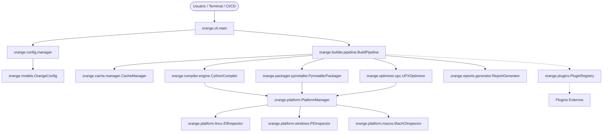

# Arquitetura Interna do Orange Framework

O Orange Framework foi projetado com uma arquitetura **modular, desacoplada e orientada a serviços**, separando estritamente as responsabilidades de compilação, empacotamento, otimização, suporte a plataformas e interface com o usuário.

---

## 1. Diagrama de Arquitetura

---

## 2. Divisão Modular de Responsabilidades

| Módulo | Responsabilidade |
|---|---|
| `orange.cli` | Interface de linha de comando com Click, formatação resiliente de terminal (UTF-8/ASCII) e códigos de saída adequados para CI/CD. |
| `orange.config` | Validação de schema Pydantic/dataclass, carregamento e parsing de `orange.toml`, mesclagem com perfis e sobrescritas de flags da CLI. |
| `orange.compiler` | Motor de transpilação Cython para C, invocação do compilador C nativo (`gcc`, `clang`, `cl.exe`) e resolução de bibliotecas dinâmicas. |
| `orange.builder` | Orquestrador do pipeline de compilação, ligando compilação, empacotamento, otimização e geração de relatórios. |
| `orange.packager` | Abstração sobre o PyInstaller, geração dinâmica de arquivos `.spec` e inclusão de binários compilados (`.so`/`.pyd`). |
| `orange.optimizer` | Otimização e compressão de executáveis standalone utilizando UPX. |
| `orange.platform` | Abstração multiplataforma: detecção de ferramentas, análise de binários ELF (Linux), PE/UAC (Windows) e Mach-O (macOS). |
| `orange.cache` | Cache incremental baseado em SHA-256 do código-fonte e opções de compilação, evitando recomputação de módulos inalterados. |
| `orange.plugins` | Sistema extensível de plugins dinâmicos e ciclo de vida (`BasePlugin`, `BaseHookPlugin`, `PluginLoader`). |
| `orange.reports` | Emissão de métricas em formatos JSON, HTML e Terminal, além de comparação com execuções anteriores (`BuildComparator`). |
